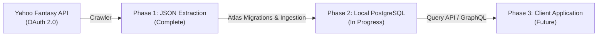

# Project Plan: Yahoo Fantasy Football League Archive & Service

## Overview
A backend service and data pipeline to extract, normalize, and archive Yahoo Fantasy Football league data across historical seasons into a local PostgreSQL database for consumption by a separate client application.

---

## Architecture Roadmap

---

## Phase 1: OAuth & JSON Extraction (Complete)
- [x] Yahoo OAuth 2.0 3-legged authentication with Out-of-Band (`oob`) code exchange.
- [x] Auto-persisting token rotation cache (`.tokens.json`).
- [x] Single-season test extraction (`bun run fetch`).
- [x] Historical renewal-chain crawler (`bun run fetch:all`).
- [x] Formatted JSON export to `output/latest-league.json`.
- [x] Normalized relational TypeScript interfaces (`src/types/league.ts`).

---

## Phase 2: Local PostgreSQL & Atlas Migrations (Current)

### 1. Database Lifecycle (Docker Compose)
- Lightweight `docker-compose.yml` defining `postgres:16-alpine`.
- Commands:
  - `bun run db:up`: start background PostgreSQL container.
  - `bun run db:down`: stop container.
  - `bun run db:reset`: wipe volume, start fresh, and re-apply all migrations.

### 2. Schema Management & Migrations (Atlas)
- **`schema.sql`**: Declarative DDL defining target PostgreSQL tables (`leagues`, `seasons`, `teams`, `managers`, `standings`, `matchups`, `draft_picks`).
- **`atlas.hcl`**: Atlas environment configuration defining database targets and dev container simulation.
- **`migrations/`**: Version-controlled SQL migration files tracked with `atlas.sum` integrity manifests.
- **Workflow**:
  - `bun run db:diff <name>`: generate new versioned migration.
  - `bun run db:apply`: execute pending migrations against local Postgres.
  - `bun run db:status`: view migration status.
  - `bun run db:lint`: pre-migration safety and lint checks.

### 3. Ingestion Pipeline
- **Database Client** (`src/db/client.ts`): connection pool manager.
- **Ingestion Service** (`src/service/dbService.ts`): atomic transaction-wrapped upserts for extracted historical league JSON.
- **CLI Ingest Runner** (`src/scripts/ingestLeagueData.ts`): `bun run ingest`.

---

## Phase 3: Client Application & API Layer (Future)
- [ ] Read-only query endpoints for historical standings, manager head-to-head records, all-time scoring leaderboards, and matchup boxscores.
- [ ] Connect client frontend application.

agy --conversation=27ae3fc0-fbbb-4ce7-814b-94dab7bfc561

