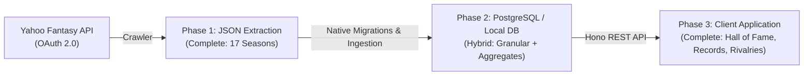

# Project Plan: Yahoo Fantasy Football League Archive & Service

## Overview
A backend service, data pipeline, and analytics API to extract, normalize, archive, and analyze Yahoo Fantasy Football league data across historical seasons (2010–2026) for consumption by a separate client application.

---

## Architecture Roadmap

---

## Phase 1: OAuth & JSON Extraction (Complete)
- [x] Yahoo OAuth 2.0 3-legged authentication with Out-of-Band (`oob`) code exchange.
- [x] Auto-persisting token rotation cache (`.tokens.json`).
- [x] Single-season test extraction (`bun run fetch`).
- [x] Historical renewal-chain crawler (`bun run fetch:all`).
- [x] 17 full seasons (2010–2026) exported to `output/latest-league.json` (1.5 MB).
- [x] Normalized relational TypeScript interfaces (`src/types/league.ts`).

---

## Phase 2: Database Architecture & Hybrid Ingestion (Complete)

### 1. Database Lifecycle & Migrations
- Lightweight Docker Compose (`docker compose up -d`) or native local macOS PostgreSQL.
- **Bun Native Migration Runner** (`src/scripts/migrate.ts`): zero external CLI dependencies (`bun run db:migrate`).
- Schema migrations tracked in `schema_migrations` and `migrations/`.

### 2. Hybrid Data Architecture
- **Granular Normalized Tables**:
  - `leagues`: League profile.
  - `seasons`: Yearly instances, team count, scoring type.
  - `teams`: Team profile, logo, season key.
  - `managers`: Team managers, GUIDs, commissioner status.
  - `standings`: Final ranks, records, streaks, points for/against.
  - `matchups`: Weekly box scores, playoffs flag, team scores, winner.
  - `draft_picks`: Full annual draft boards.
- **Persisted Analytical Aggregate Tables** (populated post-ingest):
  - `manager_career_stats`: All-time titles, podiums, sackos, win %, total points, PPG.
  - `head_to_head_records`: Pairwise rivalry matrix between all managers.
  - `league_records`: Top 10 leaderboards for single-game and season-level records.

### 3. Ingestion Pipeline
- `src/service/dbService.ts`: Ingests JSON export into granular tables and automatically triggers `AnalyticsService.persistAggregates()`.
- CLI Runner: `bun run ingest`.

---

## Phase 3: Analytics Engine & Client Query API (Complete)

### 1. Historical Analytics Service (`src/service/analyticsService.ts`)
- **Cross-Era Identity Resolution**: Maps historical `--hidden--` nicknames to real owners using Yahoo GUIDs across all 17 seasons.
- **Hall of Fame Rankings**: Rings, podiums, career win %, PPG.
- **Single-Game Top 10 Leaderboards**:
  - Highest Single-Game Scores (Brian: 234.66)
  - Lowest Single-Game Scores (Adam: 30.38)
  - Biggest Blowouts (Nate: +187.30 margin)
  - Closest Nailbiters (0.02 pt margin)
  - Highest Scoring Shootouts (355.68 combined)
  - Tough Luck Losses (166.58 in an L)
  - Lucky Wins (62.70 in a W)
- **Season-Level Top 5 Extremes & Awards**:
  - Highest Scoring Seasons (Nate: 141.86 PPG)
  - Worst Winners (Nate: 89.68 PPG in 2010; VC: 101.78 PPG in 2017)
  - Highest Scoring Dildo / Unluckiest Sacko (Ross G: 108.63 PPG in 2024)
  - Lowest Scoring Dildo / Most Pathetic Sacko (Plum Smugglers: 76.52 PPG in 2010)
  - Biggest Chokes (Nate 2021: 141.86 PPG, finished #4; James Bauer 2020: 132.92 PPG, finished #4)
  - Unluckiest Schedules (Adam Cotter 2020: 122.66 Points Against per game)
  - Luckiest Schedules (Nate 2010: 75.94 Points Against per game)

### 2. Hono REST Query Endpoints (`src/routes/analyticsRoutes.ts`)
- `GET /api/leagues`: List archived leagues.
- `GET /api/leagues/:id/hall-of-fame`: Career leaderboards, rings, podiums, sackos, win %, PPG.
- `GET /api/leagues/:id/records`: Top 10 single-game and season records (filterable via `?type=...`).
- `GET /api/leagues/:id/rivalries`: Head-to-head match records (optional `?m1=...&m2=...`).
- `GET /api/leagues/:id/managers/:guid`: Manager player card and 17-season historical breakdown.
- `GET /api/leagues/:id/seasons`: List of all 17 seasons and champions.
- `GET /api/leagues/:id/seasons/:season/matchups`: Weekly boxscores (supports `?week=...` and `?playoffs=...`).

### 3. CLI Analytics Runner
- `bun run analytics`: Instantly calculates and formats all tables in the terminal.

---

## Verification & Testing
- Automated test suite (`bun test`): 11 tests passing across math, analytics, and Hono endpoints.
- TypeScript builds: `bun build --target=bun src/index.ts`.
